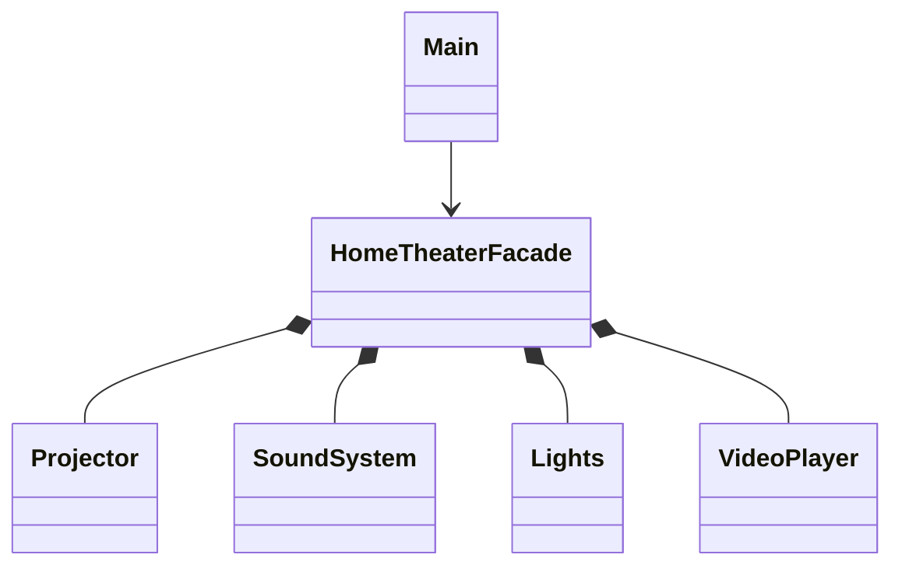

# Үй кинотеатры — Facade паттерні

Java 11 немесе одан жаңа JDK. VS Code: Extension Pack for Java.

File → Open Folder арқылы жоба папкасын ашыңыз. src/Main.java файлын ашып Run Java басыңыз.

Windows PowerShell терминалында балама іске қосу:

```powershell
javac -encoding UTF-8 -d bin src/*.java
java -cp bin Main
```

Facade құрылғылардың жұмысын бір интерфейске біріктіреді. Main тек HomeTheaterFacade әдістерін шақырады. Бұл нақты құрылғылар емес, консольдік симуляция.


